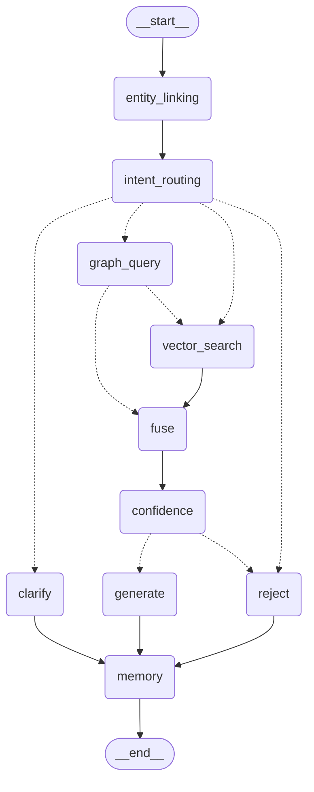

# 王者荣耀 GraphRAG 问答 Agent

自然语言提问 → 实体链接 + 意图识别 → **Neo4j 图谱**（结构化关系）与 **Chroma 向量库**（非结构化攻略）双路召回**可追溯依据** → 融合生成**带来源标注**的回答；依据不足时拒答或澄清反问。

## 数据来源与使用声明

> 本节按规格书 6.5 要求显式声明数据来源、抓取时间、覆盖规模、生成数据与已知局限。

- **来源**：王者荣耀官方公开页面（`pvp.qq.com` 英雄详情页 / 装备与铭文列表页），由
  `scripts/fetch_official.py` 按 **0.6s/请求**限速抓取，快照落在 `data/raw/<时间戳>/`；
  **抓取时间 2026-10-14**，`patch=2026-10`（端点清单见规格书 6.1b）。
- **覆盖规模**：英雄 **133** · 装备 **115** · 铭文 **93** · 英雄关系 **798 条**（源数据层）·
  语料 **138 篇**（C1 官方聚合 133 + C2 LLM 生成 5）。
- **可追溯**：每条关系与每篇语料均保留原始 `source` URL，可点回官方页面核对；审核清单见
  [`data/REVIEW.md`](data/REVIEW.md)。
- **生成数据（非官方原文）**：`data/guides/c2-*.md` 共 **5 篇**「对线思路」为 **LLM 生成**
  （`data_source=llm_assisted`，事实源为官方页面、表达由模型撰写），已在 `data/REVIEW.md` §3.1 单列待审。
- **版权与使用范围**：本项目**仅用于技术演示与学习**，**未用于任何商业用途**。
  仓库虽已公开，但**库内不含官方全量文案**——C1 语料（`data/guides/c1-*.md`，官方表达性文本聚合）与
  抓取快照（`data/raw/`）**均不入库**（`.gitignore` 排除），由脚本从快照**确定性重建**（见「快速开始」前置步骤）；
  经 `POST /api/docs/upload` 上传的攻略文本遵循同一规则（`doc_id` 强制 `upload-*` 前缀，落盘文件同样被排除）。
- **已知局限（主动声明）**：官方每英雄仅 **2+2 条**克制数据，密度低于玩家社区认知；数据随版本变化，
  需重新抓取才能跟进新版本。完整清单见下文「数据局限」。

## 三条核心设计

1. **图谱引导向量**（graph-guided retrieval）：混合类问题由图谱先取结构化事实作为扩展查询词喂给向量检索，两路融合——GraphRAG 相对普通 RAG 的价值所在（规格书 2.1）。
2. **模板化 Cypher**：LLM 只输出 `{intent, slots}`，绝不接触查询字符串（规格书 2.2 / 4.7）。
3. **三档置信度 + 确定性拒答**：澄清反问 / 拒答 / 低置信降级 / 正常回答，判定由确定性规则完成（规格书 4.9）。

## 架构与处理流程

编排层为 LangGraph `StateGraph`，实际编译结果（`graph.get_graph().draw_mermaid()` 导出，M3 验收项）：



实线 = 无条件边，虚线 = 条件边。**两条并行检索分支**（`graph_query` ∥ `vector_search`）汇到 `fuse`；
`confidence` 按三档置信度分流到 `generate`（正常回答）或 `reject`（拒答）；
`intent_routing` 可在检索前直接分流到 `clarify`（指代不明 → 澄清反问）或 `reject`（越界/未知实体）。
所有路径最终经 `memory` 落 checkpointer（`thread_id = session_id`，多轮记忆）。

| 节点 | 职责 |
| --- | --- |
| `entity_linking` | 别名表 → 拼音模糊，封闭实体集（133 英雄 + 115 装备 + 93 铭文 + 5 分路），不调 LLM |
| `intent_routing` | 确定性关键词规则 → 7 类意图 + 槽位；多意图在 `matched_intents` 留痕 |
| `graph_query` | 模板化 Cypher（7 个参数化模板）取结构化事实，绝不拼接查询字符串 |
| `vector_search` | Chroma（bge）+ BM25 → RRF 融合，按 `hero_ids`/`patch` 元数据过滤 |
| `fuse` | 两路证据融合 + citation 编号（1-based，与答案 `【1】` 对齐） |
| `confidence` | 三档判定：正常 / 低置信降级 / 拒答（确定性规则，规格书 4.9） |
| `generate` | 证据摘录组装（`template`）或云端 LLM 生成（`llm`）+ **生成后校验**（guard） |
| `clarify` / `reject` | 澄清反问（带可点候选）/ 拒答，明确返回 `citations=[]` |
| `memory` | 写 SqliteSaver checkpoint；`DELETE /api/session/{id}` 清该 thread |

## 技术栈

Python 3.12 · FastAPI · LangGraph（SqliteSaver 多轮记忆）· Neo4j 5.x · Chroma（嵌入式）· bge-large-zh-v1.5 · BM25 混合检索 · Vue3 单页

外部依赖**仅 Neo4j 一个**（Docker 或 Desktop）；Chroma 与会话记忆零外部依赖（规格书 4.12）。

## 里程碑状态

| 里程碑 | 状态 | 模块说明 | 交付报告 |
| --- | --- | --- | --- |
| M0 骨架与环境 | ✅ 完成 | [`m0-skeleton.md`](docs/module-notes/m0-skeleton.md) | — |
| M1a 数据层（抓取 + 样例） | ✅ 完成（需求方审核通过） | [`m1a-data.md`](docs/module-notes/m1a-data.md) | [`M1a-report.md`](docs/milestones/M1a-report.md) |
| M1b 数据层（全量 133 英雄） | ✅ 完成（需求方审核通过） | [`m1b-data.md`](docs/module-notes/m1b-data.md) | [`M1b-report.md`](docs/milestones/M1b-report.md) |
| M2 检索层 | ✅ 完成（需求方审核通过） | [`m2-retrieval.md`](docs/module-notes/m2-retrieval.md) | [`M2-report.md`](docs/milestones/M2-report.md) |
| M3 LangGraph 编排 | ✅ 完成（需求方审核通过，三项修改已落实） | [`m3-orchestration.md`](docs/module-notes/m3-orchestration.md) | [`M3-report.md`](docs/milestones/M3-report.md) |
| M4 生成层 | ✅ 完成（需求方二审通过；裁定 A / B1–B3 / C1 已落实） | [`m4-generation.md`](docs/module-notes/m4-generation.md) | [`M4-report.md`](docs/milestones/M4-report.md) |
| M5 前端 | ✅ 完成（需求方审核通过；按 1.6 边界，不引 Pinia/Router/UI 库） | [`m5-frontend.md`](docs/module-notes/m5-frontend.md) | [`M5-report.md`](docs/milestones/M5-report.md) |
| M6 评测 | ✅ 完成（需求方二审通过；147 turn 固化答案集口径、8.2 全指标实测） | [`m6-eval.md`](docs/module-notes/m6-eval.md) | [`eval_report.md`](docs/eval_report.md) |
| M7 打磨 | ✅ 完成（README 定稿 + 演示脚本 + 接口补全 + 最终验收） | — | [演示脚本](docs/demo-script.md) · [最终验收证据](docs/milestones/M7-verify-output.txt) |

## 环境要求

| 项 | 要求 | 说明 |
| --- | --- | --- |
| Python | **3.12** | `py -3.12 -m venv .venv` |
| Neo4j | **5.x** | **唯一外部依赖**；用 Docker（`docker-compose.yml`）或 Neo4j Desktop |
| Docker | 可选 | 仅当用 Docker 跑 Neo4j 时需要（需先启动 Docker Desktop 守护进程） |
| Node.js | 18+ | 仅前端需要（Vite） |
| 网络 | 首次需联网 | 拉 embedding 模型（ModelScope）；生成侧走云端 LLM，需 API Key |

Chroma 与多轮记忆（SQLite）**零外部依赖**；embedding 模型 1.24GB 走本地目录加载、不入库（规格书 4.12）。

## 快速开始（陌生人 15 分钟跑起来）

> **前置步骤不能省**：`models/`（1.24GB embedding 模型）与 `data/guides/c1-*.md`（C1 语料）
> **都不在版本库内**（前者太大、后者是官方表达性文本的派生数据）。跳过第 2、3 步，向量库会是空的、
> 检索层建不起来。

```powershell
# 0) 配置：复制 .env.example 为 .env，填入云端 LLM 的 CLOUD_API_KEY / CLOUD_BASE_URL / CLOUD_CHAT_MODEL
Copy-Item .env.example .env

# 1) 建 venv 并装依赖（Windows，Python 3.12）
py -3.12 -m venv .venv
.\.venv\Scripts\python -m pip install -r requirements.txt

# 2) 【前置】下载 embedding 模型（bge-large-zh-v1.5，约 1.24GB，断点续跑）
.\.venv\Scripts\python scripts\download_embedding_model.py

# 3) 【前置】重建数据层：抓取快照 → 重建 C1 语料 → 导入图谱与向量库
.\.venv\Scripts\python scripts\fetch_official.py      # 落 data/raw/<时间戳>/（约 2 分钟，限速 0.6s/请求）
.\.venv\Scripts\python scripts\build_graph_data.py    # 从快照导出入库数据
.\.venv\Scripts\python scripts\build_guides.py        # 从快照重建 C1 语料（133 篇，确定性可复现）
docker-compose up -d                                  # 起 Neo4j（注意：带横线的 docker-compose）
.\.venv\Scripts\python scripts\init_graph.py          # 导入 Neo4j（MERGE 幂等）
.\.venv\Scripts\python scripts\init_chroma.py         # 导入 Chroma（切分 + bge embedding，删库重建）

# 4) 启动 API
.\.venv\Scripts\python -m uvicorn app.main:app --host 127.0.0.1 --port 8000

# 5) 验证三项组件状态
curl http://127.0.0.1:8000/api/health   # 期望 {"neo4j":{"ok":true,...},"chroma":{"ok":true,...},"llm":{"ok":true,...}}
```

跑通后按 [`docs/demo-script.md`](docs/demo-script.md) 的演示问题清单逐条体验（附预期输出与真实跑批结果）。

## 接口清单（与规格书 5.2 表**逐条一致**）

> 规格书 v1.6 §5.2 要求「README 的接口清单必须与本表一致，不得出现『README 列了但没实现』」。
> 下表与 5.2 表逐条对应，含实现状态。

| 方法 | 路径 | 说明 | 实现状态 |
| --- | --- | --- | --- |
| POST | `/api/chat` | SSE 流式问答 | ✅ 已实现（M5） |
| POST | `/api/chat/sync` | 同步问答（评测用，返回完整 `ChatResponse`） | ✅ 已实现 |
| GET | `/api/health` | 返回 `{neo4j, chroma, llm}` 三项状态 | ✅ 已实现 |
| DELETE | `/api/session/{session_id}` | 清空会话状态 | ✅ 已实现（M6，幂等；清 checkpointer 中 `thread_id = session_id` 的全部 checkpoint） |
| POST | `/api/docs/upload` | 上传攻略文本（multipart，必须带 metadata） | ✅ 已实现（M7；与全库重建共用切分与元数据转换，同 `doc_id` 重复上传为整体替换） |
| POST | `/api/graph/relations` | 按英雄查图谱关系（克制 / 搭档 / 出装 / 铭文），只读 | ✅ 已实现（补丁 P1-1；`relation` 枚举即项目一公开意图名，依赖不可用一律 503 不降级） |
| POST | `/api/retrieval/search` | 向量 + BM25 混合检索攻略**原文片段**，只读 | ✅ 已实现（补丁 P1-2；直接调用 `bm25.hybrid_search`，依赖不可用一律 503 不降级） |
| PUT | `/api/graph/relations` | 单条关系 upsert（**高危写端点**，仅 `COUNTERS` / `SYNERGIZES`） | ✅ 已实现（补丁 P1-3；写前校验节点存在 + 写后模板回读 `verified`，回读不到即 500） |
| POST | `/api/graph/import` | 导入图谱数据（幂等，整体校验后才写入） | ❌ v1 不实现完整版（见「非目标」）；**单条关系写入**由 `PUT /api/graph/relations` 以受限形式提供（补丁 P1-3） |

## 前端（M5，最简聊天页）

```powershell
# 1) 后端先起来（见上「启动」）
.\.venv\Scripts\python -m uvicorn app.main:app --host 127.0.0.1 --port 8000

# 2) 前端开发模式（Vite，/api 自动代理到 8000）
cd frontend
npm install
npm run dev          # http://127.0.0.1:5173

# 3) 生产构建（产出静态文件到 frontend/dist）
npm run build
```

前端依赖仅 `vue` + `vite`（**无 Pinia / Router / UI 库**，规格书 1.6 边界）。
功能：多轮消息列表、SSE 流式逐字显示、节点过程指示、可展开的来源卡片、
拒答 / 澄清反问的差异化渲染（澄清候选可点选）。`dist/` 与 `node_modules/` 均不入版本库。

## 数据层构建（M1b，可复现）

```powershell
# 1) 抓取官方数据（全量 133 英雄 + 装备 + 铭文），落快照并生成覆盖率报告
.\.venv\Scripts\python scripts\fetch_official.py

# 2) 从快照导出入库数据（全量 133 英雄）
.\.venv\Scripts\python scripts\build_graph_data.py

# 3) 从快照重建 C1 官方聚合语料（每英雄一篇，确定性：publish_date 取自快照 fetch_meta.json）
#    注：C1（data/guides/c1-*.md）为**派生数据**，不入版本库（.gitignore），由本步从 data/raw/ 重建
.\.venv\Scripts\python scripts\build_guides.py

# 4) 导入 Neo4j（MERGE 幂等）
.\.venv\Scripts\python scripts\init_graph.py

# 5) 导入 Chroma（切分 + bge embedding，删库重建保证幂等）
.\.venv\Scripts\python scripts\init_chroma.py

# 6) 生成审核清单与度数画像
.\.venv\Scripts\python scripts\build_review.py
.\.venv\Scripts\python scripts\data_profile.py

# 7) 回归测试（幂等 / 配对 / 算子差异 / EF 重启）
.\.venv\Scripts\python -m pytest -v
```

## 图谱复位（补丁 P1，写脏后回基线）

`scripts/init_graph.py` 是**纯 MERGE**，它只写不删 —— 一旦通过 `PUT /api/graph/relations`
写入了一条额外关系，重跑 `init_graph.py` **修不回来**（MERGE 认的是「起点+类型+终点+patch」唯一键，
键不同的脏关系永远匹配不到、自然也不会被覆盖）。而数据层基线（341 节点 / 3165 关系 / COUNTERS 527）
是写进本 README 并被 `scripts/verify_data_layer.py` 断言的。

```powershell
# 语义：MATCH ()-[r]->() DELETE r 删掉全部关系，再复用 init_graph.import_all 从 data/graph/*.json 全量重建
# （只删关系、不删节点：P1-3 唯一能改的就是关系，节点保持不动可避免约束/索引被短暂拆掉）
.\.venv\Scripts\python scripts\reset_graph.py

# 复位后核对基线（以本脚本为准，打印前后计数）
.\.venv\Scripts\python scripts\verify_data_layer.py   # 期望 341 节点 / 3165 关系 / COUNTERS 527
```

## 数据来源与数据画像（M1b）

> 数据来自王者荣耀官方页面脚本抓取（`scripts/fetch_official.py`，端点清单见规格书 6.1b），
> 每条数据带真实 `source` URL 与 `patch=2026-10`。**仅本地演示用，勿用于生产。**

> **版本库内数据范围**：`data/graph/*.json`（结构化事实）与 `data/guides/c2-*.md`（5 篇 LLM 生成语料，
> **须提交以保证评测可复现**）在库内；`data/raw/`（抓取快照）与 `data/guides/c1-*.md`（133 篇，
> 从快照解析出的**派生数据**）**不入库**（见 `.gitignore`），由上方「数据层构建」步骤重建
> —— 故库内**不含官方表达性文本**，而本地重建后语料完整、检索质量不受影响。

> **关系计数口径（全项目统一）**：关系计数分三层，本文所有关系数字均注明层级——
> **源数据层**（`parsed/relations_all.json`，798 行 / COUNTERS 532）·
> **导出层**（`data/graph/relations.json`，798 行 / COUNTERS 532，**未去重**）·
> **入库后层**（Neo4j 按唯一键 MERGE 去重，793 边 / COUNTERS 527）。

**规模**：英雄 133 · 装备 115 · 铭文 93 · 英雄关系 **798 条（源数据层；COUNTERS 532 / SYNERGIZES 266；入库后 793 / COUNTERS 527）** · 语料 **138** 篇（C1 133 + C2 5）。
抓取与覆盖率详见 [`data/fetch_report.md`](data/fetch_report.md)，审核清单见 [`data/REVIEW.md`](data/REVIEW.md)，
COUNTERS 出度/入度画像与边界英雄清单见 [`data/data_profile.md`](data/data_profile.md)。

### 数据洞察：反向遍历拿到的信息比正向查询多

官方每个英雄详情页只给 **2 条「压制英雄」+ 2 条「被压制英雄」**，正向看每个英雄的克制数据都均等地是 2+2。
但同一批事实在 133 个页面里互相引用，因此把 hr3 方向反转入库后，**反向遍历能恢复出远超 2 条的度数**：

- **出度**（本英雄压制别人）最高（**源数据层口径**）：花木兰 27、兰陵王 24、貂蝉 19；
- **入度**（本英雄被别人压制）最高（**源数据层口径**）：鲁班七号 29、后羿 20、王昭君 17。

> 入库后去重口径下，5 个含重复边的英雄出度各 −1（花木兰 26、兰陵王 23、王昭君 9、孙膑 8、露娜 3），
> 对应 5 个英雄入度各 −1（墨子 6、鲁班七号 28、李白 7、吕布 9、虞姬 4）；逐条对照见 `data/data_profile.md`。

例：兰陵王被 **22** 个英雄（**源数据层口径**）列为压制对象，而亚瑟 **0** 个。这个差异本身就是**版本强度的信号**，
也正是图的价值所在——「谁克制 X / X 克制谁」这类问题只有反向遍历才能拿到完整答案。

### 数据局限

1. **官方克制数据稀疏且非对称**：每页恒为 2+2 条，密度低于玩家社区认知；官方不提供关系权重，
   `weight` 统一 1.0（语义仅为「官方认定该关系存在」，见 DECISIONS.md）。
2. **71 个英雄的 hr3 反向引用 = 0**（从未被任何其他英雄页面列为「被压制英雄」，其中包含亚瑟）。
   对这些英雄问「XX 被谁克制」时，图谱**必然返回空**，会走拒答或降级——这是真实边界情况，
   是 M6 评测集的重要素材，完整清单见 [`data/data_profile.md`](data/data_profile.md)。
3. **4 个装备 ID 缺失**（`1223`/`1225`/`1722`/`91040`，共 20 处引用）不在官方 `item.json` 中，
   对应 `RECOMMENDS_ITEM` 边**未建立、未造桩节点**（缺失装备在任何数据源中都不存在，造桩即编造）。
   详见 [`data/fetch_report.md`](data/fetch_report.md)。
4. **C2 语料为 LLM 生成**（5 篇对线思路，事实源为官方页面，`data_source=llm_assisted`），非官方原文，
   已在 [`data/REVIEW.md`](data/REVIEW.md) §3.1 单列待审。
5. **数据随版本变化**：当前 `patch=2026-10`，需重新抓取才能跟进新版本。

## 评测结果（规格书 8.2，覆盖集 / 泛化集分开统计）

> **口径声明**：下表除注明外均基于**单份固化答案集**（[`docs/milestones/M6-golden-answers.json`](docs/milestones/M6-golden-answers.json)，
> 147 turn · `deepseek-v4-pro` · `temperature=0.0` / `seed=42`）。v4-pro 存在与采样参数无关的**内置非确定性**
> （实测同输入连跑 3 次仅 2/5 组逐字一致），故**点估计 ≠「换台机器复跑也是这个数」**——涉及小样本的比例一律
> 附区间或注明单集口径（见下文「已知局限」）。完整报告与逐条错误样例见 [`docs/eval_report.md`](docs/eval_report.md)。

| 指标 | 目标 | 实测 | 结论 |
| --- | --- | --- | --- |
| 意图路由准确率（覆盖集 73 turn） | ≥85% | **72/73 = 98.6%** | 通过 |
| 意图路由准确率（泛化集 74 turn） | ≥85% | **63/74 = 85.1%** | 通过（刚好过线） |
| 实体链接准确率（覆盖集 / 泛化集） | ≥90% | **34/34 = 100%** / **53/53 = 100%** | 通过 |
| 检索 Recall@5（覆盖集） | ≥80% | **26/26 = 100%** | 通过 |
| **答案有据率**（LLM-as-judge + 人工抽检各 50%） | — | **≈ 96.7% ± 2pt**（单份固化答案集点估计 **77/78 = 98.7%**） | 通过（口径见下） |
| 拒答正确率（双向） | ≥85% | 合计 **144/147 = 98.0%**；该拒未拒 2/43 = 4.7%、不该拒乱拒 1/104 = 1.0% | 通过 |
| 首 token 延迟（llm 生成路径） | ≤2.5s | **mean 4.22s**（n=7） | **未达标**（已登记偏差，见下节） |
| 首 token 延迟（template / 非生成路径） | ≤2.5s | **mean 0.02s** | 通过 |
| 复合意图占比 | — | **6/147 = 4.1%** | → 多意图合并**永久不做** |

> **D1 之后的评测集规模（口径标注，勿混）**：`tests/eval/freeform.yaml` 于 2026-10-16 追加 **4 条「零提示自然说法」用例**
> （`F-75 ~ F-78`，缺陷 D1 的 L4 交付，每条标注需求方手测来源），泛化集**文件规模**由 74 → **82 turn**。
> 上表「泛化集 74 turn」是 **M6 指标口径**（单份固化答案集 147 turn）的**分母**，**不因 D1 而改变**——这 4 条全部落在
> **澄清路径**（检索前分流、不调用 LLM、离线可验），按「离线可验证的改动不得触发答案重新生成」原则**不重跑 M6**。
> 故引用泛化集指标时分母是 **74（M6 口径）**，不是 82（当前文件规模）。详见
> [`docs/milestones/D1-report.md`](docs/milestones/D1-report.md) §10。

> **「答案有据率」区间口径（务必连区间一起引用）**：点估计 98.7% 来自 78 条候选答案的**单次**跑批，
> 分母仅 78，且判官自身有 1 条误报（全量判官口径 97.4% 比人工复核低 1.3pt），故按 **≈ 96.7% ± 2pt** 报。
> 这是**对单份固化答案集的保守区间**，**不是**多次重复采样得到的置信区间（模型内置非确定性使「逐字重放」不成立）；
> 已如实登记于 [`docs/eval_report.md`](docs/eval_report.md) §2.4.1 / §2.10。
> **不得单独引用 98.7%**——那会把「单次单集」读成「稳定值」。

## 已知偏差（**显式记录，不是隐藏缺陷**）

### 首 token 延迟：正常回答路径达不到 3.4 的「≤2.5s」

规格书 3.4 的目标是「首 token ≤ 2.5s（流式）」。**本实现在「正常 answer + llm 路径」下达不到**。

**根因（M6 审核后修正，2026-10-16）**：**主因是推理模型的思考前置，次因才是 guard 需完整正文。**

- **主因：推理模型的思考前置。** `deepseek-v4-pro` 先输出 250~290 token 的 `reasoning_content`，
  正文（`content`）在其后才开始产生 —— 首 token 被**思考时间**主导。同一批真实问句实测：
  v4-pro 首 token **5.01s**（reasoning_tokens 均值 233），`deepseek-chat` 首 token **1.09s**
  （reasoning_tokens=0），两者答案有据率同为 **7/7 = 100%**（`scripts/compare_first_token_models.py`，
  见 `docs/milestones/M6-firsttoken-model-compare-output.txt`）。**注**：7 条为小样本对照，此处
  `100%` 仅用于**相对比较**（同一批问句上两模型质量等价），**不可作为绝对有据率引用**。
- **次因：guard 需完整正文。** guard 必须拿完整正文才能判（G2 英雄名越界要全篇比对、
  G3 类别化外推要按句子窗口判），未校验的内容推出去撤不回，故正文在**校验通过之后**才按块推。
  但 M6 实测**句级增量校验收益 0.00s**（整段答案只有 1 句）—— 该改法换不来收益，
  故它**不是** 4.22s 的主因，只是一个次要叠加项。

**范围澄清**：`_template_body` 路径**构造上不可能越界**（只摘录 evidence，不归纳不改写），无需等校验，
故**拒答 / 降级 / template 路径的首 token 是快的**；**只有「正常 answer + llm 路径」慢**。

**处置**（规格书 v1.6 §3.4）：

1. 本条即第 1 项要求 —— 在 README 与 M6 评测报告中显式记录，说明原因
   （**主因：推理模型思考前置；次因：guard 需完整正文**）；
2. M6 已实测首 token 延迟并给出真实数字（8.2 要求分开统计，见下表）；
3. M6 已评估**句级增量校验**：实测收益 **0.00s**（整段答案只有 1 句），
   **裁定不切换**，维持「完整生成 + 全文校验」；
4. M6 已补做**模型对比**：`deepseek-chat` 首 token **1.09s**（达标）且该批答案有据率 100%。
   结论：**4.22s 是选型问题，不是不可消除的设计取舍** —— 模型名已由 `CLOUD_CHAT_MODEL` 配置，
   **默认 `deepseek-v4-pro`（质量优先），演示可切 `deepseek-chat`（首 token 达标）**。

**M6 实测结论（2026-10-16，见 [`docs/eval_report.md`](docs/eval_report.md) §2.5）**：

| 路径 | 首 token（mean） | 完整回答（mean） | n |
| --- | --- | --- | --- |
| llm 生成路径（v4-pro） | **4.22s**（min 0.44 / max 9.62） | 6.74s | 7 |
| llm 生成路径（deepseek-chat，对照） | **1.09s**（min 0.88 / max 1.36） | 1.41s | 7 |
| template / 非生成路径 | **0.02s** | 0.02s | 3 |

- **句级增量校验裁定：不切换。** 直连模型流实测整段答案**只有 1 句**（推理模型先出 reasoning
  再一次性吐正文），句级提前推送正文收益 **0.00s**；82 条真实 LLM 答案中「全文判越界但句级前缀
  判不出」的跨句依赖样本 **0 条**。
- 结论：**该偏差由「推理模型选型」主导**，切 `deepseek-chat` 即可达标（1.09s）；
  默认仍取 v4-pro 是**质量优先**的取舍，已在 DECISIONS.md 与本节显式登记。

### 感知改善：citation 已提前到生成之前推（v1.6 §3.4）

依据在检索阶段就已确定（citation 就是融合后 evidence 的 1-based 序号），故 `citation` 事件
**在生成开始前就推给前端**，用户立刻看到「查到了这些依据」，来源卡片也更早渲染 —— 感知延迟大降。
注意这**不满足**「首 token」的字面指标（那是 `token` 事件），改善的是实际体验。

> 实现细节：`citation` 挂在 `node_start(generate)` 处推，而**不是**在 fuse 之后无条件推 ——
> `reject_node` / `clarify_node` 明确返回 `citations=[]`（拒答不给来源卡片），
> 而**低置信拒答**这条路径是跑过 fuse 的，若在 fuse 处无条件推会出现「推了来源、终态却说没有来源」。
> 挂在 generate 起点则只在「真要出答案」的分支推，与终态 citations 必然一致。
> 每条路径**恰好一次** `citation` 事件（拒答/澄清在末尾补一次空 citation）。

## 非目标（v1 明确不做）

- **`POST /api/graph/import`（批量导入端点）**：幂等导入的**核心能力已存在且被测试覆盖** ——
  `scripts/init_graph.py` 支持幂等重跑，`tests/...::test_neo4j_import_idempotent` 钉住了该行为。
  API 端点只是对同一能力的 HTTP 包装，**边际价值低**；而实现它需要额外的鉴权、大文件分片、
  部分失败回滚等设计，性价比不足。故 v1 明确不提供该端点（规格书 v1.6 §5.2）。
  **补丁 P1 以受限形式补上了「单条关系写入」**（`PUT /api/graph/relations`，仅 `COUNTERS` / `SYNERGIZES`），
  批量导入端点仍不提供；P1-3 只做输入校验与写入协议，鉴权 / 限流 / 审计由下游网关负责（本仓库不引入第二套鉴权）。
- 登录 / 历史会话管理页 / 设置页 / 主题切换 / 移动端适配 / 动画特效（规格书 1.6）。

## 已知局限

- **多意图合并：永久不做（M6 裁定）。** 评测原始记录（固化答案集，147 turn）实测，一个 turn 命中 ≥2 个意图的仅
  **6/147 = 4.1%**，且这 6 条没有一条是用户真要两个答案 —— 5 条是**关键词误命中**
  （「貂蝉的铭文怎么搭配」里「搭配」命中 SYNERGY、「貂蝉对线思路」里「对线」命中 MATCHUP），
  1 条是同一关系的两种说法。为 4.1% 且多为误命中的场景做合并，是把复杂度花在噪声上。
  当前行为：**一次只答一个意图**，其余命中的意图在 `matched_intents` 留痕并在回答中告知。
  详见 [`docs/eval_report.md`](docs/eval_report.md) §2.9。
- **意图路由对自由口语的覆盖有上限**：泛化集（74 条真实用户口吻）准确率 **85.1%**，
  11 条错误**全部**是「关键词表覆盖不到自由口语」（如「能打过谁」「怎么发育」「配谁」），
  **没有一条是路由逻辑判错**。同批 108 条上本地 LLM 意图路径只有 **41.7%**、延迟是规则的 330 倍，
  故生产路径只保留确定性规则；`route_llm` 与 Ollama 依赖已按 M6 裁定**整体删除**（预案被数据否决，
  见 DECISIONS.md 2026-10-16 条）。

- **评测指标基于单份固化答案集，存在采样噪声（如实声明）**：`deepseek-v4-pro` 是推理模型，实测
  **存在与 `temperature` / `seed` 无关的内置非确定性**（同问句 + 同依据连跑 3 次，仅 2/5 组逐字一致）。
  故 8.2 各指标（尤其分母小的答案有据率、拒答率）**不是「换台机器复跑必然复现」的常数**：
  报告一律附区间（如答案有据率 **≈ 96.7% ± 2pt**）或注明「基于单份固化答案集」。
  答案集已固化（`M6-golden-answers.json`）以保证**同一批判定跨轮次可比**，但**跨机器的绝对数值可能小幅波动**。
  这是选型带来的局限，不隐藏。
- **`guard` 是启发式下限，不是完备的越界检测**：生成后校验用正则 + 别名表 + 语料溯源判定，
  只能拦住**已枚举的越界形态**（英雄名越界、类别化外推），对未知形态无能为力；
  且为控误报做过两条放松（R3 角色描述、G2 英雄别名可溯源），**放松处即漏拦风险所在**。
  M6 实测生产路径触发率仅 1/79，样本太薄、不足以证明「几乎不越界」，只说明**当前评测集上未见**。
- **`MATCHUP`（对位）只有「谁克制谁」，没有逐对位打法**：库里图谱只存英雄间克制/搭档关系，
  **没有「铠 对 吕布」这类任意两英雄对的打法文本**，故这类问题会退回通用克制事实，
  模型可能判定证据不足、如实回「资料不足。」（M7 演示 H-01 实测即如此，见
  [`docs/demo-script.md`](docs/demo-script.md) §四·观察 3）。**这不是空答案也不是拒答**，
  是检索粒度局限——要真正回答「怎么打」，需要按英雄对抓取对位攻略语料，当前数据源不提供。
- **C2 语料为 LLM 生成**：5 篇对线思路的事实源是官方页面，但表达由模型撰写（`data_source=llm_assisted`），
  不能当作官方口径引用；已在 `data/REVIEW.md` §3.1 单列待审。

## 技术决策记录

见 [DECISIONS.md](DECISIONS.md)（规格书 0.1 铁律 2：未定义决策先记录再实现）。
