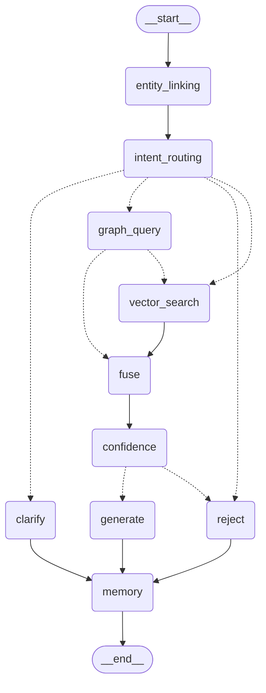

# M3 交付报告 — LangGraph 编排层（不接 LLM 生成）

> 生成日期：2026-10-15　规格书：v1.4　快照：`data/raw/20261014-230459`
> 格式依据：规格书 11.3（四项缺一视为未完成）。
> **状态：已完成，按 11.4-4 停下等待需求方审核，未进入 M4。**
> 本报告同时给出 M2 审核三项强制条件（意图路由测试 / 准确率数字 / 多意图留痕）与两条记录性要求的落实结论。

---

## 1. 变更文件清单

### 1.1 新增（M3）

| 文件 | 说明 |
| --- | --- |
| `app/agent/state.py` | `AgentState`（`TypedDict, total=False`）：输入 / 实体意图 / 检索 / 置信度 / 生成 / 记忆三项 / 兜底 |
| `app/agent/coref.py` | 指代消解三条规则集中定义（指代词表、简短阈值、追问标记、按 ID 回填实体） |
| `app/agent/routing.py` | 意图 → 检索分支 / 话题类型唯一映射（GRAPH / VECTOR / HYBRID 分组） |
| `app/agent/graph.py` | 图组装 + 三条条件边 + `run` / `stream_events` / `draw_mermaid` 入口 |
| `app/agent/nodes/entity_linking.py` | 节点 [0] 实体链接 + 规则 1 |
| `app/agent/nodes/intent.py` | 节点 [1] 意图路由 + 槽位 + 规则 2/3 |
| `app/agent/nodes/graph_query.py` | 节点 [2a] Neo4j 查询 + 降级收敛（不抛 500） |
| `app/agent/nodes/vector_search.py` | 节点 [2b] 向量检索（复用 M2 `hybrid_search`，不重写） |
| `app/agent/nodes/fuse.py` | 节点 [3] 融合去重 + `top_score` |
| `app/agent/nodes/confidence.py` | 节点 [4] 三档置信度（确定性规则，不交 LLM） |
| `app/agent/nodes/generate.py` | 节点 [5] 确定性答案组装 + citation |
| `app/agent/nodes/clarify.py` | 节点 [6a/6b] 澄清 + 拒答 + 可选 `interrupt` |
| `app/agent/nodes/memory.py` | 节点 [6] 记忆写入（两条「不覆盖」策略） |
| `app/memory/checkpointer.py` | `AsyncSqliteSaver` 封装（进程单例 + 测试用 `open_checkpointer`） |
| `app/api/chat.py` | `/api/chat/sync` 最小骨架（5.2 要求必须存在） |
| `tests/integration/conftest.py` | 内存 checkpointer 夹具（各测试独立会话库） |
| `tests/integration/test_graph_coref.py` | 四条追问链 + 记忆策略 + 多意图留痕 + mermaid + interrupt（**11 用例**） |
| `tests/integration/test_graph_degrade.py` | Neo4j 降级（图级 + API 级，**4 用例**） |
| `scripts/verify_api_smoke.py` | API 冒烟证据脚本（三条关键路径，可复跑） |
| `docs/milestones/M3-verify-output.txt` | 本批真实运行证据原样输出 |
| `docs/milestones/M3-report.md` | 本报告 |
| `docs/module-notes/m3-orchestration.md` | M3 模块三段说明（规格书 9.1-1） |

> `tests/unit/test_intent_routing.py`（**79 用例**，M3 第一项交付）已于 commit `0269e86` 入库，不在本批 diff 中。

### 1.2 修改（M3）

| 文件 | 说明 |
| --- | --- |
| `app/config.py` | 新增 `CHECKPOINT_DB`（checkpointer 落盘路径）、`COREF_SHORT_LEN`（4.10 规则 2 的「长度 < 8 字」阈值） |
| `app/main.py` | 挂载 `chat.router`（`/api/chat/sync`） |
| `app/retrieval/intent.py` | `IntentResult.matched_intents` 字段（条件三）；`_COUNTER_BY` 补「谁能针对」类问法；抽 `slots_for` / `need_clarify_for` 供路由与继承共用 |
| `app/retrieval/entity_linking.py` | 新增 `by_id` 索引与 `entity_by_id()`（供指代消解按 ID 回填可读名称）；移除分路口语单字别名「上」「中」 |
| `.gitignore` | `data/checkpoints.sqlite` → `data/checkpoints.sqlite*`（覆盖 `-shm` / `-wal`） |
| `DECISIONS.md` | 追加「M2 审核后」6 条 + 「M3 编排层」9 条 |
| `README.md` | 里程碑状态更新（M3 完成待审） |

---

## 2. 真实运行证据

> 全部证据的原样输出见 [`docs/milestones/M3-verify-output.txt`](M3-verify-output.txt)（`scripts/verify_api_smoke.py` + `scripts/verify_data_layer.py` 可复跑）。

### 2.1 pytest 全量（`python -m pytest tests -q`）

```
180 passed, 1 warning in 19.83s
```

| 文件 | 用例数 | 归属 |
| --- | --- | --- |
| `tests/test_smoke.py` | 2 | M0 冒烟 |
| `tests/test_data_pipeline.py` | 4 | M1b 数据层回归 |
| `tests/unit/test_entity_linking.py` | 58 | M2 |
| `tests/unit/test_cypher_templates.py` | 14 | M2 |
| `tests/unit/test_retrieval_chroma.py` | 8 | M2 |
| `tests/unit/test_intent_routing.py` | 79 | **M3 第一项交付** |
| `tests/integration/test_graph_coref.py` | 11 | **M3** |
| `tests/integration/test_graph_degrade.py` | 4 | **M3** |
| **合计** | **180** | M3 新增 94（79 + 15） |

1 warning 为 chromadb 内部 `is_legacy` DeprecationWarning（与断言无关，已在 `DECISIONS.md` 登记升级复跑要求）。

### 2.2 意图路由准确率（M2 审核**条件二**）

```
[intent-routing] 规则路径准确率 = 43/43 = 100.0%（自建问句集）
[intent-routing] 自由口语抽样准确率 = 16/20 = 80.0%（非验收口径）
```

- 自建覆盖集 43 条（每个意图 ≥3 条**真实问法**，含五组易混对）：100%，但与规则同源开发，存在虚高；
- **自由口语抽样 20 条：80%** —— 作为更可信的泛化估计，也是 M6「≥85%」的前置信号；
- 4 条口语盲区（「能克制」「走一路」「用什么英雄」「拿 X 我选谁」）已列入 M6 待补清单（`DECISIONS.md`）。

### 2.3 数据层复跑校验（M3 交付要求，**未破坏数据**）

```
========================================================================
[verify] 数据层复跑校验  快照 = 20261014-230459
========================================================================
【1】源数据层      英雄 = 133  装备 = 115  铭文 = 93   关系行数 = 798   COUNTERS = 532  SYNERGIZES = 266
【2】导出层        英雄 = 133  装备 = 115  铭文 = 93   关系行数 = 798   COUNTERS = 532  SYNERGIZES = 266
  [ OK ] 导出层行数 == 源数据层行数（798，未去重）
  导出层关系：source 空 = 0，patch 空 = 0，reason 空 = 0
【3】入库后层      节点 {'Hero': 133, 'Inscription': 93, 'Item': 115}
                  关系 {'COUNTERS': 527, 'RECOMMENDS_INSCRIPTION': 798, 'RECOMMENDS_ITEM': 1574, 'SYNERGIZES': 266}
  [ OK ] 幂等：连续两次导入后节点数/关系数逐项不变
  [ OK ] 入库后 COUNTERS（527）== 去重后口径（源 532 − 合并 5）
  [ OK ] 入库后 SYNERGIZES（266）== 去重后口径（源 266 − 合并 0）
  完整性：Hero/Item/Inscription 的 source 空 = 0、patch 空 = 0；关系 source 空 = 0、patch 空 = 0；
          COUNTERS.reason 空 = 0、SYNERGIZES.reason 空 = 0
【4】向量库        collection.count() = 540  缺 patch/hero_ids/source_url = 0/0/0  patch 分布 = {'2026-10': 540}
========================================================================
[verify] 结论：PASS —— 数据层复跑校验全部通过，检索层未破坏数据
========================================================================
```

**与 M1b 完全一致**：341 节点 / 3165 关系（133+93+115 节点；527+798+1574+266 关系）/ COUNTERS 527 / 空值全 0。
计数口径三层逐项标明（源数据层 / 导出层 / 入库后层）。

### 2.4 API 冒烟（`scripts/verify_api_smoke.py`，真实 HTTP 响应）

**A 正常路径（Neo4j 可用）**

```
POST /api/chat/sync  question='铠被谁克制'
  HTTP 200   type=low_confidence  intent=COUNTER_BY  confidence=0.0
  entities=['铠']   citations=4
  debug.matched_intents=['COUNTER_BY']   debug.degraded=False  graph_available=True
  answer='以下内容依据较少，仅供参考。\n【图谱依据】\n- 公孙离 克制 铠：…\n- 芈月 克制 铠：…\n- 蒙恬 克制 铠：…\n- 诸葛亮 克制 铠：…'

POST /api/chat/sync  question='铠的出装和铭文'
  HTTP 200   type=low_confidence  intent=INSCRIPTION  confidence=0.0
  entities=['铠']   citations=6
  debug.matched_intents=['INSCRIPTION', 'ITEM_BUILD']   debug.degraded=False  graph_available=True
  answer='…【图谱依据】\n- 铠 第1套铭文 · 红：传承 …（共 6 条铭文）'
```

**B Neo4j 断开（monkeypatch 模拟，图谱单路意图必须补一次向量检索）**

```
POST /api/chat/sync  question='铠被谁克制'
  HTTP 200   type=answer  intent=COUNTER_BY  confidence=0.7010252475738525
  entities=['铠']   citations=4
  debug.matched_intents=['COUNTER_BY']   debug.degraded=True  graph_available=False
  answer='（图谱不可用，以下依据来自攻略文本检索）\n【攻略依据】\n- …'
```

**C 越界拒答（全程不碰 Neo4j）**

```
POST /api/chat/sync  question='今天天气怎么样'
  HTTP 200   type=reject  intent=OUT_OF_SCOPE  confidence=0.0
  entities=[]   citations=0
  debug.matched_intents=[]   debug.degraded=False  graph_available=None
  answer='这个问题与王者荣耀无关，我无法回答。你可以问我英雄的克制关系（「铠被谁克制」）、出装…'
```

### 2.5 `graph.get_graph().draw_mermaid()` 导出（M3 验收项）



---

## 3. 验收项逐条结论

### 3.1 M2 审核三项强制条件 + 两条记录性要求

| # | 要求 | 结论 | 证据 |
| --- | --- | --- | --- |
| C1 | 意图路由测试作为 **M3 第一项交付**；每个意图 ≥3 条真实问法，重点覆盖五组易混对 | **通过** | `tests/unit/test_intent_routing.py` 79 用例：COUNTER_BY/COUNTER_OF、GAMEPLAY/MATCHUP、ITEM_BUILD/INSCRIPTION、OUT_OF_SCOPE/ENTITY_UNKNOWN 四组易混对参数化 + `test_who_counters_kai_ruling`（第五组「谁能针对铠」跨意图误判） |
| C1b | 「谁能针对铠」落点裁定 | **已裁定并固化** | 归 `COUNTER_BY`（要的是压制者名单）、「怎么针对铠」归 `MATCHUP`（要的是应对方法）；`test_who_counters_kai_ruling` 断言主意图 + `matched_intents` 同时含两者 |
| C2 | 规则路径初步准确率数字 | **通过** | §2.2：自建集 43/43 = 100%、自由口语抽样 16/20 = **80%**；4 条盲区入 M6 |
| C3 | 多意图命中必须留痕 | **通过** | `IntentResult.matched_intents` 按优先级序记录全部命中；`test_multi_intent_is_recorded` 断言 `{ITEM_BUILD, INSCRIPTION} ⊆ matched_intents`；§2.4 A 段 `debug.matched_intents=['INSCRIPTION','ITEM_BUILD']` 真实可见 |
| R1 | LLM 路径要有去留期限 | **已登记** | `DECISIONS.md` 2026-10-15：M6 评测后必须决定「启用」或「删除」，不得无限期挂着 |
| R2 | Chroma 弃用警告 + 升级复跑要求 | **已登记** | `DECISIONS.md` 2026-10-15：升级 chromadb 版本时必须复跑 `tests/unit/test_retrieval_chroma.py::test_ef_restart_regression` |

### 3.2 规格书 4.8 七条特性

| # | 4.8 特性 | 结论 | 落点 / 证据 |
| --- | --- | --- | --- |
| 1 | StateGraph + 显式 TypedDict State | **通过** | `app/agent/state.py` `AgentState`（`total=False`，节点只回局部更新） |
| 2 | 条件边 `add_conditional_edges` | **通过** | `route_after_intent` / `route_after_confidence` / `route_after_graph_query`；§2.5 mermaid 虚线即条件边 |
| 3 | 并行分支 | **通过** | `branches_for` 返回**列表** → 同一超步并行；`fuse` 为共同下游只执行一次；`test_hybrid_intent_does_not_search_vector_twice` 断言不重复检索 |
| 4 | Checkpointer 持久化（`thread_id=session_id`） | **通过** | `app/memory/checkpointer.py` `AsyncSqliteSaver`；`test_memory_isolated_across_sessions` 断言跨会话记忆隔离 |
| 5 | 降级节点（Neo4j 失败不抛 500） | **通过** | `graph_query` 捕获 `GraphUnavailable` → `degraded=True`；`route_after_graph_query` 补一次向量检索；§2.4 B 段 HTTP 200 |
| 6 | 流式事件 `astream_events` | **通过（本层）** | `graph.stream_events()` 输出节点级事件（`node_start` / `evidence` / `token` / `citation` / `done`）；SSE 端点属 M5，本层只做事件映射 |
| 7 | 可选 human-in-the-loop `interrupt` | **通过** | `clarify` 节点 `hitl=True` 时 `interrupt()` 暂停；`test_hitl_interrupt_then_resume`（`Command(resume=...)` 续跑）+ `test_default_path_does_not_interrupt`（默认不挂起） |

### 3.3 M3 验收项（需求方放行要求）

| # | 验收标准 | 结论 | 证据 |
| --- | --- | --- | --- |
| 1 | 多轮追问**四条测试链**全部通过（4.10） | **通过** | `test_graph_coref.py`：链1 铠被谁克制→那铭文呢（跨意图）/ 链2 亚瑟怎么出装→那他怕谁（跨检索路径 hybrid→graph）/ 链3 貂蝉怕什么→怎么打（省略主语，规则 3）/ 链4 东皇太一→他克制谁（纯指代） |
| 2 | Neo4j 断开的降级 | **通过** | `test_graph_degrade.py` 4 用例：图级（真的补跑向量检索 + 答案标注降级 + 话题类型不因降级改变）+ API 级（200 而非 500） |
| 3 | `graph.get_graph().draw_mermaid()` 导出 | **通过** | `test_draw_mermaid_contains_core_structure`（逐条断言主干/条件边/并行/终态）+ `test_graph_object_exportable`（调用链本身）+ §2.5 |
| 4 | 交付时复跑数据层校验并附真实输出 | **通过** | §2.3 原样输出，结论 PASS，与 M1b 完全一致 |
| 5 | 模块三段说明（9.1-1） | **通过** | `docs/module-notes/m3-orchestration.md`（为什么这么设计 / 会被问什么 / 怎么答） |
| 6 | 附录 A 目录结构 | **通过** | `app/agent/`（state / coref / routing / graph / nodes）、`app/memory/`、`tests/integration/` 落地 |

---

## 4. 未达标项及需需求方确认事项

**无硬性验收项未通过。** 以下为需需求方知晓 / 裁定的事项（关键项已记入 `DECISIONS.md` 2026-10-15）：

1. **【需裁定】图谱单路意图的答案一律落 `low_confidence`。**
   §2.4 A 段：「铠被谁克制」图谱返回 4 条官方事实，但**没有向量相似度可比**（`top_score=None`），
   按 M3 保守口径判为「低置信」并在答案前加「依据较少，仅供参考」。根因是 4.9 表格未定义
   「图谱单路、无文本证据」这一格，而 COUNTER_BY 这类图谱单路意图本来就不排 `vector_search`。
   M3 先按「绝不拒答」的保守口径实现，**M4 按 4.9 表格正式复核该格**。请确认此过渡口径可接受。

2. **【需知晓】多意图「只取一个」的真实后果已在证据里可见。**
   §2.4 A 段第二问：「铠的出装和铭文」`matched_intents=['INSCRIPTION','ITEM_BUILD']`，
   主意图取 `INSCRIPTION`，答案只给铭文、**未给出装**。按条件三「不要求现在就做多意图合并，但必须看得见」——
   已可见（`debug.matched_intents` + 日志 warning）。是否在 M4/M6 做多意图合并，请裁定。

3. **【需知晓】指代消解补了「规则 3」（省略主语继承实体）。**
   4.10 必测链「貂蝉怕什么 → 怎么打」按规则 1/2 的字面条件都不会继承（无指代词、意图已被关键词判定），
   但语义上必须继承「貂蝉」。补的规则加了三个门控（无实体 + 命中意图关键词 + 简短）以免误伤无关短问句。
   同时**追问标记词刻意不收「怎么」**（「今天天气怎么样」含「怎么」却是越界问句）。两项均已登记 DECISIONS。

4. **【需知晓】`hitl` 默认 False。**
   `interrupt` 仅在 `hitl=True` 时启用，默认澄清直接返回文本、不暂停图 —— M6 批量评测不会被澄清挂起。

5. **【需知晓】`/api/chat/sync` 本层不包 try/except。**
   降级是 `graph_query` 节点的职责，异常在编排层内部已收敛；若在 API 层再兜一层，会把真正的编程错误
   （如 State 字段拼错）一起吞掉。M3 验收要的「Neo4j 断开返回 200」由**编排层**保证，而非 API 层兜底。

6. **【已按要求完成】git 分组提交。**
   本批按「feat(m3): 编排层图与节点」「feat(m3): /api/chat/sync 最小骨架」「test(m3): 集成测试」「docs(m3): 报告 / 模块说明 / 证据输出」分组提交；
   工作树干净（`data/checkpoints.sqlite*` 已进 `.gitignore`）。

---

## 5. 下一步

按规格书 11.4-4，**M3 结束停下等待需求方审核**，不进入 M4。请重点审核：

- `app/agent/` 十个节点与三条条件边的实现口径（尤其 **降级兜底边** `route_after_graph_query` 与 **规则 3**）；
- `tests/integration/` 两条测试文件的断言是否真正覆盖验收（非仅节点调用次数）；
- `docs/milestones/M3-verify-output.txt` 的真实输出（pytest / 准确率 / 数据层复跑 / API 冒烟）；
- `docs/module-notes/m3-orchestration.md` 的三段说明是否覆盖面试追问点；
- `DECISIONS.md` 2026-10-15「M2 审核后」与「M3 编排层」两节共 15 条决策。

M4 为**生成层**（接入 LLM、prompt 集中维护），届时将按 4.9 表格复核 §4-1 的置信度过渡口径。
